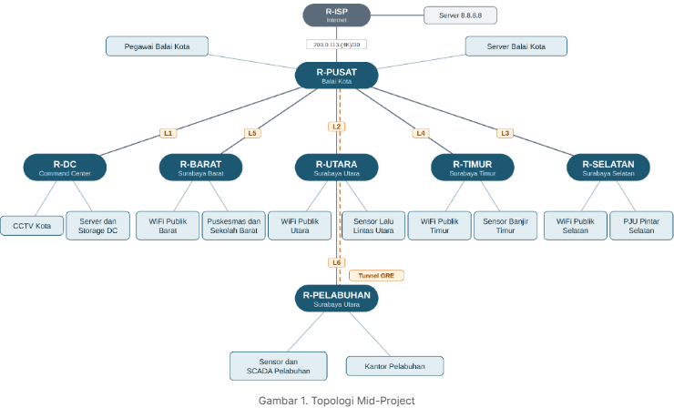
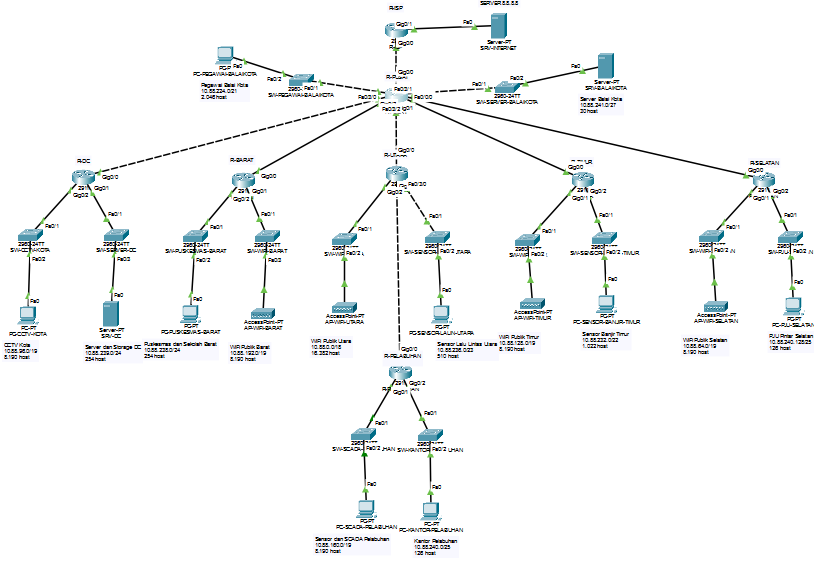

# MidProject Jarkom

| Nama                   | NRP        |
| ---------------------- | ---------- |
| M. Rama Maulana Wafa   | 5027251019 |
| Nabila Nafisatus Zuhro | 5027251073 |
| Wahyu Yoga Wicaksono   | 5027251103 |

### Soal 1

Buatlah topologi jaringan sesuai dengan gambar di bawah ini. Buatlah konfigurasi IP address pada setiap perangkat yang ada di topologi tersebut.



Berikut adalah topologi jaringan pada Cisco Packet Tracer



### Soal 2

Berikut tabel subnetting
- [Tabel Subnettng](tabel_subnetting.xlsx)

Tabel VLSM

Cara menghitung dengan VLSM adalah sebagai berikut:

1. Tentukan jumlah host yang dibutuhkan untuk setiap subnet
2. Urutkan jumlah host dari yang terbesar ke yang terkecil
3. Tentukan Prefix IP Address untuk setiap subnet
4. Tentukan Subnet Mask untuk setiap subnet
5. Tentukan Network ID untuk setiap subnet dimulai dari subnet pertama
6. Tentukan Broadcast ID untuk setiap subnet
7. Tentukan range IP Address untuk setiap subnet

Tabel CIDR

Cara menghitung dengan CIDR adalah sebagai berikut:

1. Tentukan prefix tiap subnet
2. Kelompokkan subnet per router, lalu jumlahkan ukuran blok
3. Cari supernet tiap router
4. Alokasikan supernet berurutan dari yang terbesar
5. Bagi subnet di dalam supernet memakai offset
6. Hitung kolom host dan broadcast
7. Alokasikan link antar router (/30) dari pool terpisah
8. Ringkas semuanya menjadi satu blok akar

Catatan:
Revisi tabel VLSM : pada saat ETS ada kesalahan dalam menghitung Network ID karena kurang teliti

Revisi tabel CIDR : pada saat ETS tidak membuat tabel CIDR
### soal 3

- Seluruh LAN dapat saling berkomunikasi hanya dengan static route (dan default route untuk arah keluar).

- Default route hanya boleh mengarah ke router di atasnya / keluar. Misalnya, default route R-DC ke R-PUSAT, R-PELABUHAN ke R-UTARA, dan R-PUSAT ke R-ISP.

- R-PUSAT dan R-UTARA wajib memiliki static route ke jaringan di bawahnya (ke dalam):
  - R-PUSAT: ke semua LAN milik R-DC, R-UTARA, R-PELABUHAN, R-SELATAN,

  - R-TIMUR, dan R-BARAT.

  - R-UTARA: ke semua LAN milik R-PELABUHAN

Pada soal ini, kita diminta untuk membuat konfigurasi static routing pada router-router yang ada di topologi jaringan. Setiap router harus memiliki rute statis yang mengarah ke jaringan-jaringan yang berada di bawahnya, serta default route yang mengarah ke router di atasnya atau keluar dari jaringan.

berikut confignya

- [Config soal 3](foto/konfigurasi_static_routing_soal_no_3.md)

Setelah itu, kita lihat rute dari R-PUSAT dan R-UTARA dengan perintah `show ip route` pada masing-masing router. Hasilnya adalah sebagai berikut:


# Dokumentasi Implementasi Jaringan Smart City Surabaya
## Kelompok 11 — Mid-Project Komunikasi Data dan Jaringan Komputer

Dokumentasi ini membahas implementasi dan pengujian tiga bagian jaringan Smart City Surabaya, yaitu DHCP (Soal 4), Network Address Translation (Soal 5), serta layanan aplikasi DNS, Web, FTP, dan Email (Soal 8).

Topologi dibangun menggunakan Cisco Packet Tracer dengan skema pengalamatan VLSM. Setiap wilayah terhubung melalui router dan jaringan backbone menuju R-PUSAT sebagai pusat konektivitas.

---

# 4. Implementasi DHCP

## 4.1 Tujuan

DHCP (Dynamic Host Configuration Protocol) digunakan untuk memberikan konfigurasi jaringan secara otomatis kepada perangkat pengguna. Dengan DHCP, administrator tidak perlu menetapkan alamat IP secara manual pada setiap perangkat.

Konfigurasi yang diberikan meliputi:

- IP Address
- Subnet Mask
- Default Gateway
- DNS Server

Sesuai ketentuan proyek, seluruh interface router dan server menggunakan IP statis. Sementara itu, perangkat pengguna memperoleh IP dinamis tanpa mengalami konflik dengan alamat yang sudah digunakan oleh perangkat statis.

Khusus subnet CCTV Kota, layanan DHCP disediakan oleh server di LAN Server dan Storage DC, bukan langsung oleh router R-DC.

## 4.2 Desain DHCP

DHCP diterapkan menggunakan dua mekanisme:

1. **Router-based DHCP**, yaitu router menyediakan DHCP pool untuk perangkat pengguna pada LAN yang dilayaninya.
2. **DHCP Relay**, yaitu router meneruskan permintaan DHCP menuju server DHCP yang berada pada subnet berbeda.

Pada jaringan CCTV Kota, R-DC menggunakan DHCP Relay untuk meneruskan permintaan alamat IP menuju SRV-DC.

### Informasi pengalamatan

| Komponen | Alamat IP | Fungsi |
|---|---|---|
| R-PUSAT | 10.88.224.1 | Gateway LAN Pegawai Balai Kota |
| R-DC | 10.88.96.1 | Gateway LAN CCTV Kota |
| SRV-DC | 10.88.239.2 | DHCP Server CCTV Kota |
| Perangkat pengguna | DHCP | Memperoleh IP otomatis |

## 4.3 Konfigurasi DHCP pada Router

Pada R-PUSAT, sebagian alamat IP dicadangkan menggunakan perintah:

```cisco
ip dhcp excluded-address 10.88.224.1 10.88.224.10
```

Alamat yang dikecualikan tidak akan diberikan kepada perangkat melalui DHCP.

DHCP pool untuk LAN Pegawai Balai Kota bernama:

```text
POOL-PEGAWAI-BALAIKOTA
```

Konfigurasi dapat diperiksa melalui CLI router menggunakan:

```cisco
enable
show ip dhcp pool
show ip dhcp binding
show running-config
```

Perintah `show ip dhcp pool` menampilkan informasi pool DHCP, sedangkan `show ip dhcp binding` menunjukkan alamat yang telah dialokasikan kepada klien.

## 4.4 Konfigurasi DHCP Relay pada R-DC

Subnet CCTV Kota menggunakan DHCP Server yang berada di LAN Server dan Storage DC.

Konfigurasi interface R-DC yang melayani CCTV Kota:

```cisco
interface GigabitEthernet0/2
 ip address 10.88.96.1 255.255.224.0
 ip helper-address 10.88.239.2
```

Perintah `ip helper-address` digunakan karena DHCP Discover dikirim sebagai broadcast. Secara default, router tidak meneruskan broadcast antar-subnet.

Dengan DHCP Relay, permintaan DHCP dari perangkat CCTV dapat diteruskan menuju SRV-DC yang berada di jaringan berbeda.

### Alur DHCP CCTV Kota

1. Perangkat CCTV mengirimkan DHCP Discover.
2. R-DC menerima permintaan pada interface LAN CCTV.
3. R-DC meneruskan permintaan menuju SRV-DC melalui DHCP Relay.
4. Server DHCP memproses permintaan dan menawarkan alamat IP.
5. Perangkat menyelesaikan proses DHCP hingga memperoleh konfigurasi jaringan.

## 4.5 Pengujian DHCP

Pengujian dilakukan melalui perangkat PC pada Cisco Packet Tracer.

Langkah pengujian:

1. Pilih PC pengguna.
2. Buka menu **Desktop > IP Configuration**.
3. Pilih opsi **DHCP**.
4. Periksa IP Address, Subnet Mask, Default Gateway, dan DNS Server.
5. Lakukan pengujian serupa pada perangkat CCTV Kota.

### Hasil Pengujian

| Pengujian | Hasil yang Diharapkan | Hasil Aktual |
|---|---|---|
| DHCP Pegawai Balai Kota | IP diperoleh otomatis | [Isi hasil] |
| DHCP CCTV Kota | IP diperoleh dari SRV-DC | [Isi hasil] |
| Default Gateway | Sesuai gateway subnet | [Isi hasil] |
| DNS Server | Sesuai konfigurasi DHCP | [Isi hasil] |
| Konflik IP | Tidak terdapat konflik | [Isi hasil] |

### Dokumentasi Screenshot

**Gambar 4.1 — Konfigurasi DHCP Pool pada Router**


**Gambar 4.2 — DHCP Relay pada R-DC**


**Gambar 4.3 — Hasil DHCP pada PC CCTV Kota**


## 4.6 Analisis

Penerapan DHCP mempermudah pengelolaan alamat IP pada jaringan yang terdiri atas banyak perangkat dan subnet.

Penggunaan excluded-address mencegah DHCP mengalokasikan alamat yang telah dicadangkan untuk perangkat statis.

Sementara itu, DHCP Relay memungkinkan layanan DHCP dipusatkan pada SRV-DC tanpa harus menyediakan server DHCP tersendiri pada subnet CCTV Kota.

---

# 5. Implementasi Network Address Translation (NAT)

## 5.1 Tujuan

Network Address Translation (NAT) digunakan untuk memungkinkan perangkat pada jaringan internal mengakses jaringan luar menggunakan alamat IP publik.

Sesuai ketentuan proyek, seluruh host harus dapat mengakses server 8.8.8.8 menggunakan satu alamat IP publik milik R-PUSAT.

Selain itu, R-ISP tidak boleh memiliki rute menuju alamat privat internal.

## 5.2 Desain NAT

Implementasi menggunakan **Port Address Translation (PAT)** atau NAT Overload.

PAT memungkinkan beberapa perangkat dengan alamat IP privat menggunakan satu alamat IP publik secara bersamaan.

Informasi pengalamatan:

| Komponen | Alamat | Keterangan |
|---|---|---|
| Jaringan internal | 10.88.0.0/16 | Blok alamat privat |
| R-PUSAT | 203.0.113.46 | IP publik untuk NAT |
| R-ISP | 203.0.113.45 | Router menuju internet |
| Server internet | 8.8.8.8 | Tujuan pengujian |

## 5.3 Konfigurasi NAT pada R-PUSAT

Access Control List (ACL) digunakan untuk menentukan alamat sumber yang diizinkan menggunakan NAT.

```cisco
access-list 1 permit 10.88.0.0 0.0.255.255
```

Selanjutnya, NAT Overload dikonfigurasi menggunakan:

```cisco
ip nat inside source list 1 interface GigabitEthernet0/0 overload
```

Perintah tersebut menerjemahkan alamat sumber yang cocok dengan ACL menjadi alamat IP pada interface GigabitEthernet0/0.

Interface yang mengarah ke jaringan internal menggunakan:

```cisco
ip nat inside
```

Sedangkan interface menuju R-ISP menggunakan:

```cisco
ip nat outside
```

Dengan konfigurasi ini, beberapa host internal dapat mengakses jaringan luar melalui satu alamat publik.

## 5.4 Mekanisme NAT

Alur komunikasi NAT adalah sebagai berikut:

1. PC internal mengirim paket menuju 8.8.8.8.
2. Paket diteruskan melalui router menuju R-PUSAT.
3. R-PUSAT memeriksa apakah alamat sumber sesuai ACL NAT.
4. R-PUSAT menerjemahkan alamat sumber privat menjadi IP publik 203.0.113.46.
5. Paket diteruskan menuju R-ISP.
6. Balasan dari server internet diterima oleh R-PUSAT.
7. R-PUSAT menggunakan tabel NAT untuk meneruskan balasan kepada host internal yang sesuai.

Pada PAT, identifikasi sesi dilakukan menggunakan nomor port atau identifier protokol yang relevan.

## 5.5 Pengujian NAT

Pengujian dilakukan dari PC internal melalui Command Prompt:

```bash
ping 8.8.8.8
```

Pengujian perlu dilakukan dari beberapa subnet untuk membuktikan bahwa NAT tidak hanya bekerja pada satu wilayah.

Setelah menghasilkan lalu lintas, tabel NAT diperiksa melalui CLI R-PUSAT:

```cisco
enable
show ip nat translations
show ip nat statistics
```

Kolom penting pada tabel NAT:

- **Inside Local:** alamat IP privat host internal.
- **Inside Global:** alamat IP publik hasil translasi.
- **Outside Global:** alamat IP tujuan pada jaringan luar.

### Pemeriksaan Routing R-ISP

Pada R-ISP, jalankan:

```cisco
show ip route
```

R-ISP seharusnya hanya mengetahui jaringan yang diperlukan untuk komunikasi eksternal, tanpa rute menuju blok privat internal 10.88.0.0/16.

### Hasil Pengujian

| Pengujian | Hasil yang Diharapkan | Hasil Aktual |
|---|---|---|
| Ping 8.8.8.8 dari Balai Kota | Reply diterima | [Isi hasil] |
| Ping 8.8.8.8 dari CCTV Kota | Reply diterima | [Isi hasil] |
| Ping 8.8.8.8 dari Pelabuhan | Reply diterima | [Isi hasil] |
| Tabel NAT | Menampilkan translasi IP | [Isi hasil] |
| Routing R-ISP | Tidak memiliki rute privat internal | [Isi hasil] |

### Dokumentasi Screenshot

**Gambar 5.1 — Konfigurasi NAT R-PUSAT**


**Gambar 5.2 — Pengujian Ping ke 8.8.8.8**


**Gambar 5.3 — Tabel NAT Translation**


**Gambar 5.4 — Routing Table R-ISP**


## 5.6 Analisis

PAT dipilih karena memungkinkan banyak perangkat internal berbagi satu alamat IP publik.

Penggunaan satu IP publik mengurangi kebutuhan alokasi alamat publik, sekaligus mempertahankan pemisahan antara alamat jaringan internal dan eksternal.

R-ISP tidak perlu mengetahui seluruh subnet privat karena translasi dilakukan oleh R-PUSAT. Dengan demikian, komunikasi menuju internet dapat berlangsung tanpa menambahkan rute privat internal pada router ISP.

---

# 8. Implementasi Layanan Aplikasi Smart City

## 8.1 Tujuan

Layanan aplikasi dibangun untuk mendukung kebutuhan operasional Smart City Surabaya.

Empat layanan yang diimplementasikan adalah:

1. **DNS**, untuk menerjemahkan nama domain menjadi alamat IP.
2. **Web**, sebagai portal informasi Smart City Surabaya.
3. **FTP**, sebagai penyimpanan rekaman CCTV.
4. **Email**, sebagai sarana komunikasi antarpegawai.

Domain internal yang digunakan adalah:

```text
k11.smartcity.lab
```

## 8.2 Arsitektur Layanan

| Layanan | Server | IP Address |
|---|---|---|
| DNS | SRV-DC | 10.88.239.2 |
| Web | SRV-BALAIKOTA | 10.88.241.2 |
| FTP | SRV-DC | 10.88.239.2 |
| Email | SRV-BALAIKOTA | 10.88.241.2 |

Penempatan layanan mempertimbangkan fungsi masing-masing wilayah.

SRV-DC digunakan untuk DNS dan penyimpanan data CCTV, sedangkan SRV-BALAIKOTA digunakan untuk portal web dan komunikasi email.

---

## 8.3 Implementasi DNS

### Konfigurasi

DNS dikonfigurasi melalui menu:

**SRV-DC > Services > DNS**

Record yang digunakan:

| Nama Domain | IP Address | Fungsi |
|---|---|---|
| www.k11.smartcity.lab | 10.88.241.2 | Portal Web |
| ftp.k11.smartcity.lab | 10.88.239.2 | FTP Server |
| mail.k11.smartcity.lab | 10.88.241.2 | Mail Server |

DNS memungkinkan pengguna mengakses layanan berdasarkan nama domain, bukan hanya alamat IP.

### Pengujian

Pengujian dilakukan melalui Command Prompt pada PC:

```bash
ping www.k11.smartcity.lab
ping ftp.k11.smartcity.lab
ping mail.k11.smartcity.lab
```

Apabila DNS bekerja dengan benar, nama domain akan diterjemahkan menjadi alamat IP yang sesuai.

Keberhasilan resolusi nama dan keberhasilan ping perlu diperiksa secara terpisah karena keduanya menguji fungsi yang berbeda.

### Dokumentasi

**Gambar 8.1 — DNS Record pada SRV-DC**


**Gambar 8.2 — Pengujian Resolusi DNS**


---

## 8.4 Implementasi Web Server

### Konfigurasi

Web Server ditempatkan pada SRV-BALAIKOTA.

Konfigurasi dilakukan melalui:

**SRV-BALAIKOTA > Services > HTTP**

Layanan HTTP diaktifkan untuk menyediakan halaman portal.

Halaman web yang digunakan berjudul:

**Portal Smart City Surabaya**

Halaman tersebut mencantumkan identitas Kelompok 11 sebagai bagian dari implementasi proyek.

### Pengujian

Pada PC pengguna:

1. Buka Desktop.
2. Pilih Web Browser.
3. Masukkan alamat:

```text
http://www.k11.smartcity.lab
```

Pengujian dilakukan dari beberapa wilayah untuk memastikan website dapat diakses melalui jaringan Smart City.

### Hasil yang Diharapkan

Browser menampilkan halaman Portal Smart City Surabaya dan identitas Kelompok 11.

### Dokumentasi

**Gambar 8.3 — Konfigurasi HTTP Server**


**Gambar 8.4 — Tampilan Portal Smart City Surabaya**


---

## 8.5 Implementasi FTP Server

### Tujuan

FTP digunakan untuk menyediakan tempat penyimpanan rekaman CCTV secara terpusat.

Perangkat pada LAN CCTV Kota dapat mengunggah file menuju SRV-DC melalui jaringan internal.

### Konfigurasi

FTP Server berada pada:

```text
10.88.239.2
```

Konfigurasi dilakukan melalui:

**SRV-DC > Services > FTP**

Akun yang disiapkan:

| Parameter | Nilai |
|---|---|
| Username | cctv |
| Password | cctv11 |
| FTP Server | 10.88.239.2 |

Akun FTP perlu memiliki hak akses yang memungkinkan proses upload file.

### Pengujian

Pada PC CCTV Kota, buat file pengujian bernama:

```text
rekaman-cctv.txt
```

Kemudian buka Command Prompt:

```bash
ftp 10.88.239.2
```

Masukkan username dan password yang telah dikonfigurasi.

Setelah berhasil login, jalankan:

```text
dir
put rekaman-cctv.txt
dir
quit
```

Perintah `put` digunakan untuk mengunggah file ke server.

Pengujian dinyatakan berhasil apabila autentikasi diterima dan file yang diunggah dapat ditemukan pada server FTP.

### Dokumentasi

**Gambar 8.5 — Konfigurasi FTP Server**


**Gambar 8.6 — Pengujian Upload File CCTV**


---

## 8.6 Implementasi Email Server

### Tujuan

Layanan email digunakan sebagai sarana komunikasi antara pegawai Balai Kota dan pegawai Pelabuhan.

Email dikonfigurasi menggunakan SMTP dan POP3.

- **SMTP (Simple Mail Transfer Protocol)** digunakan untuk mengirim pesan.
- **POP3 (Post Office Protocol version 3)** digunakan untuk mengambil pesan dari mail server.

### Konfigurasi

Mail Server berada pada SRV-BALAIKOTA.

Domain email:

```text
k11.smartcity.lab
```

Akun pengguna yang disiapkan:

| Pengguna | Alamat Email |
|---|---|
| Pegawai Balai Kota | pegawai1@k11.smartcity.lab |
| Pegawai Pelabuhan | pegawai2@k11.smartcity.lab |

Konfigurasi server dilakukan melalui:

**SRV-BALAIKOTA > Services > EMAIL**

SMTP dan POP3 harus diaktifkan.

### Pengujian

Pengujian dilakukan melalui aplikasi Email pada PC pengguna.

Langkah-langkah:

1. Buka aplikasi Email pada PC Pegawai Balai Kota.
2. Pastikan akun pengirim dan mail server sudah sesuai.
3. Buat pesan baru.
4. Kirim email menuju `pegawai2@k11.smartcity.lab`.
5. Buka aplikasi Email pada PC Pegawai Pelabuhan.
6. Gunakan fitur Receive untuk mengambil pesan.
7. Periksa apakah pesan telah diterima.
8. Lakukan pengiriman balasan dari Pelabuhan menuju Balai Kota.

### Hasil yang Diharapkan

Pegawai Balai Kota dan Pelabuhan dapat saling mengirim dan menerima email melalui mail server internal.

### Dokumentasi

**Gambar 8.7 — Konfigurasi Email Server**


**Gambar 8.8 — Pengiriman Email dari Balai Kota**


**Gambar 8.9 — Penerimaan Email di Pelabuhan**


---

## 8.7 Rekapitulasi Pengujian Layanan Aplikasi

| Layanan | Pengujian | Hasil Aktual |
|---|---|---|
| DNS | Resolusi domain www | [Isi hasil] |
| DNS | Resolusi domain ftp | [Isi hasil] |
| DNS | Resolusi domain mail | [Isi hasil] |
| Web | Akses portal melalui domain | [Isi hasil] |
| FTP | Login menggunakan akun CCTV | [Isi hasil] |
| FTP | Upload file dari CCTV Kota | [Isi hasil] |
| Email | Balai Kota mengirim email | [Isi hasil] |
| Email | Pelabuhan menerima email | [Isi hasil] |
| Email | Pelabuhan membalas email | [Isi hasil] |

## 8.8 Analisis

Keempat layanan aplikasi memiliki fungsi berbeda tetapi saling mendukung.

DNS mempermudah akses layanan menggunakan nama domain yang konsisten. Web menyediakan portal informasi yang dapat diakses pengguna dari berbagai wilayah. FTP mendukung penyimpanan rekaman CCTV secara terpusat, sedangkan Email menyediakan komunikasi antarpegawai.

Pemisahan server berdasarkan fungsi wilayah juga membantu pengorganisasian layanan. SRV-DC menangani DNS dan FTP, sementara SRV-BALAIKOTA menangani Web dan Email.

Agar seluruh layanan dapat diakses lintas wilayah, konfigurasi alamat IP, routing, gateway, dan DNS pada perangkat pengguna harus saling sesuai.

---

Implementasi DHCP, NAT, dan layanan aplikasi merupakan bagian penting dalam membangun jaringan Smart City Surabaya.

DHCP digunakan untuk mengotomatisasi pemberian konfigurasi jaringan kepada perangkat pengguna, dengan pengecualian alamat statis dan DHCP Relay khusus untuk CCTV Kota.

NAT menggunakan metode PAT agar perangkat internal dapat mengakses server internet 8.8.8.8 melalui satu IP publik R-PUSAT tanpa memerlukan rute privat pada R-ISP.

Sementara itu, layanan DNS, Web, FTP, dan Email mendukung kebutuhan akses informasi, penyimpanan data CCTV, serta komunikasi antarpegawai.

Keberhasilan implementasi secara keseluruhan ditentukan melalui pengujian konektivitas dan fungsi masing-masing layanan pada Cisco Packet Tracer.

---

