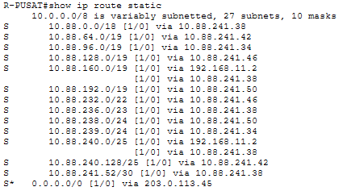
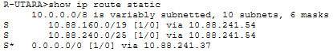

# MidProject Jarkom

| Nama                   | NRP        |
| ---------------------- | ---------- |
| M. Rama Maulana Wafa   | 5027251019 |
| Nabila Nafisatus Zuhro | 5027251073 |
| Wahyu Yoga Wicaksono   | 5027251103 |

### Soal 1

Buatlah topologi jaringan sesuai dengan gambar di bawah ini. Buatlah konfigurasi IP address pada setiap perangkat yang ada di topologi tersebut.

Berikut adalah topologi jaringan pada Cisco Packet Tracer

### Soal 2

Berikut tabel subnetting
- [Tabel Subnettng](tabel_subnetting.xlsx)

Tabel VLSM

Cara menghitung dengan VLSM adalah sebagai berikut:

1. Tentukan jumlah host yang dibutuhkan untuk setiap subnet
2. Urutkan jumlah host dari yang terbesar ke yang terkecil
3. Tentukan Prefix IP Address untuk setiap subnet
4. Tentukan Subnet Mask untuk setiap subnet
5. Tentukan Network ID untuk setiap subnet dimulai dari subnet pertama
6. Tentukan Broadcast ID untuk setiap subnet
7. Tentukan range IP Address untuk setiap subnet

Tabel CIDR

Cara menghitung dengan CIDR adalah sebagai berikut:

1. Tentukan prefix tiap subnet
2. Kelompokkan subnet per router, lalu jumlahkan ukuran blok
3. Cari supernet tiap router
4. Alokasikan supernet berurutan dari yang terbesar
5. Bagi subnet di dalam supernet memakai offset
6. Hitung kolom host dan broadcast
7. Alokasikan link antar router (/30) dari pool terpisah
8. Ringkas semuanya menjadi satu blok akar

Catatan:
Revisi tabel VLSM : pada saat ETS ada kesalahan dalam menghitung Network ID karena kurang teliti

Revisi tabel CIDR : pada saat ETS tidak membuat tabel CIDR
### soal 3

- Seluruh LAN dapat saling berkomunikasi hanya dengan static route (dan default route untuk arah keluar).

- Default route hanya boleh mengarah ke router di atasnya / keluar. Misalnya, default route R-DC ke R-PUSAT, R-PELABUHAN ke R-UTARA, dan R-PUSAT ke R-ISP.

- R-PUSAT dan R-UTARA wajib memiliki static route ke jaringan di bawahnya (ke dalam):
  - R-PUSAT: ke semua LAN milik R-DC, R-UTARA, R-PELABUHAN, R-SELATAN,

  - R-TIMUR, dan R-BARAT.

  - R-UTARA: ke semua LAN milik R-PELABUHAN

Pada soal ini, kita diminta untuk membuat konfigurasi static routing pada router-router yang ada di topologi jaringan. Setiap router harus memiliki rute statis yang mengarah ke jaringan-jaringan yang berada di bawahnya, serta default route yang mengarah ke router di atasnya atau keluar dari jaringan.

berikut confignya

- [Config soal 3](foto/konfigurasi_static_routing_soal_no_3.md)

Setelah itu, kita lihat rute dari R-PUSAT dan R-UTARA dengan perintah `show ip route` pada masing-masing router. Hasilnya adalah sebagai berikut:

